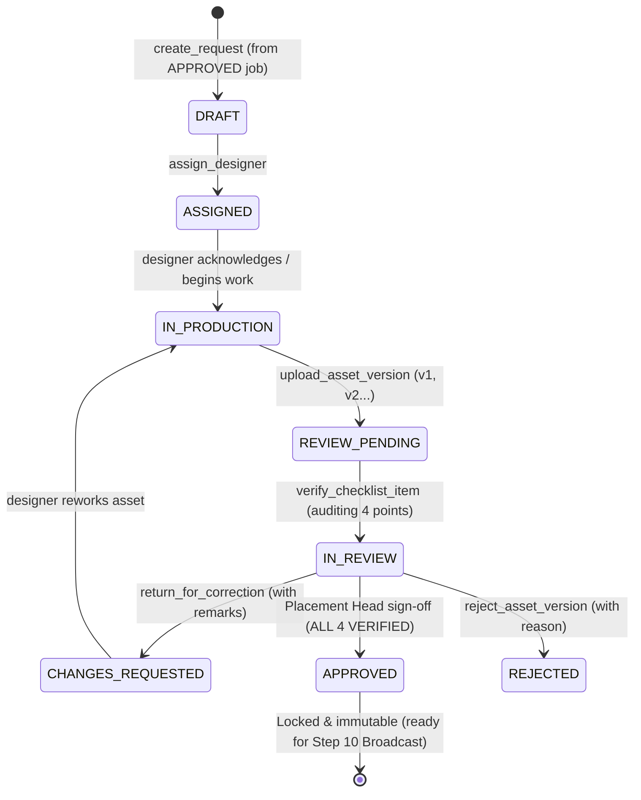

# GQT HRMS — Creative Studio & Promotional Assets Business Rules
## Authoritative Workflow Steps 8–9 Specification

### 1. Source Reference & Objectives

According to the authoritative `HRMS - Complete Workflow` document:
* **Step 8: Send to Design Team**
  - Requires approved job requirements (`JobRequirement.status == 'APPROVED'`).
  - Creates a formal promotional asset request capturing deliverable formats (flyers, banners, social posts, WhatsApp graphics).
  - Assigns request to graphic designer with copy brief, target audience, registration URL, QR code target, and production deadline.
* **Step 9: Review & Approve Design**
  - Promotional asset uploaded with binary validation and version tracking.
  - Explicit enforcement of the **4-Point Design Verification Checklist**:
    1. **Flyer Accuracy (`FLYER_ACCURACY`)**: Role title, eligibility, package, drive date, and venue match the approved JD.
    2. **Official Logo (`OFFICIAL_LOGO`)**: Official corporate employer logo and GQT institutional brand guidelines followed.
    3. **QR Code (`QR_CODE`)**: Scannable, high-contrast QR code resolving to verified registration URL.
    4. **Registration Link & Contacts (`REGISTRATION_LINK_AND_CONTACTS`)**: Legible text URL, deadline, and placement cell contact details.
  - **Approval Gate**: Strict sign-off restricted to `PLACEMENT_HEAD` or `ADMIN`, unlocked only when all 4 checklist points evaluate to `VERIFIED`.

---

### 2. Lifecycle State Machine

---

### 3. File Security & Upload Hardening

1. **Active Markup / SVG Prohibition**:
   - SVGs are rejected to prevent Stored Cross-Site Scripting (XSS) via embedded `<script>` or event attributes.
   - Header inspection scans for `<?xml`, `<svg`, and `<script` in all uploads.
2. **Binary Magic Bytes Inspection**:
   - File extensions are ignored; actual binary header bytes are inspected:
     * `PNG`: `\x89PNG\r\n\x1a\n`
     * `JPEG`: `\xff\xd8\xff`
     * `WEBP`: `RIFF....WEBP`
     * `PDF`: `%PDF-`
3. **Storage Sanitization & Randomization**:
   - Storage names are generated with random UUID4 hex strings: `creatives/assets/<request_id>/<uuid4>.<ext>`.
   - Client filenames are sanitized via `re.sub(r'[^a-zA-Z0-9_.-]', '_', filename)`.
4. **Size Boundaries**:
   - Max 10MB per asset version (`MAX_CREATIVE_UPLOAD_SIZE_BYTES = 10 * 1024 * 1024`).
5. **Pure Python Dimension Extraction**:
   - Image pixel dimensions (`width_px`, `height_px`) are parsed directly from binary PNG, JPEG, and WEBP chunks without external C-extension vulnerabilities.
6. **Authenticated Streaming Serving**:
   - Creative asset files are served exclusively through `/api/v1/creatives/requests/{id}/versions/{version_id}/file/` with DRF token/session authorization. Raw private filesystem paths are never exposed.

---

### 4. Monotonic Versioning & Immutability Rules

1. **Strict Version Progression**:
   - First upload creates `v1`. Subsequent revisions increment monotonically: `v2`, `v3`, etc.
   - Concurrency locking via `select_for_update()` prevents race conditions.
2. **Post-Approval Immutability**:
   - Once an asset version is approved (`is_approved = True`), its checklist items, files, and metadata cannot be modified (`is_locked = True`).
   - If design updates are required after approval, a new version must be uploaded, which resets the checklist and requires complete re-verification.
3. **No Overwrite**:
   - Previous versions and their decision histories are preserved indefinitely.

---

### 5. Role-Based Permission Matrix

| Operation | ADMIN | PLACEMENT_HEAD | PLACEMENT_OFFICER | CREATIVE_DESIGNER | AUDITOR | STUDENT |
| :--- | :---: | :---: | :---: | :---: | :---: | :---: |
| View Creative Requests | Yes | Yes | Yes | Yes (Assigned/Pool) | Yes (Read-Only) | No (403) |
| Create Creative Request | Yes | Yes | Yes | No | No | No (403) |
| Assign Designer | Yes | Yes | Yes | No | No | No (403) |
| Upload Asset Version | Yes | Yes | Yes | Yes (Assigned) | No | No (403) |
| Verify Checklist Item | Yes | Yes | Yes | No | No | No (403) |
| Return for Correction | Yes | Yes | Yes | No | No | No (403) |
| **Placement Head Sign-Off** | **Yes** | **Yes** | **No (403)** | **No (403)** | **No** | **No (403)** |
| Reject Asset Version | Yes | Yes | No (403) | No | No | No (403) |
| Archive / Restore | Yes | Yes | No | No | No | No (403) |
