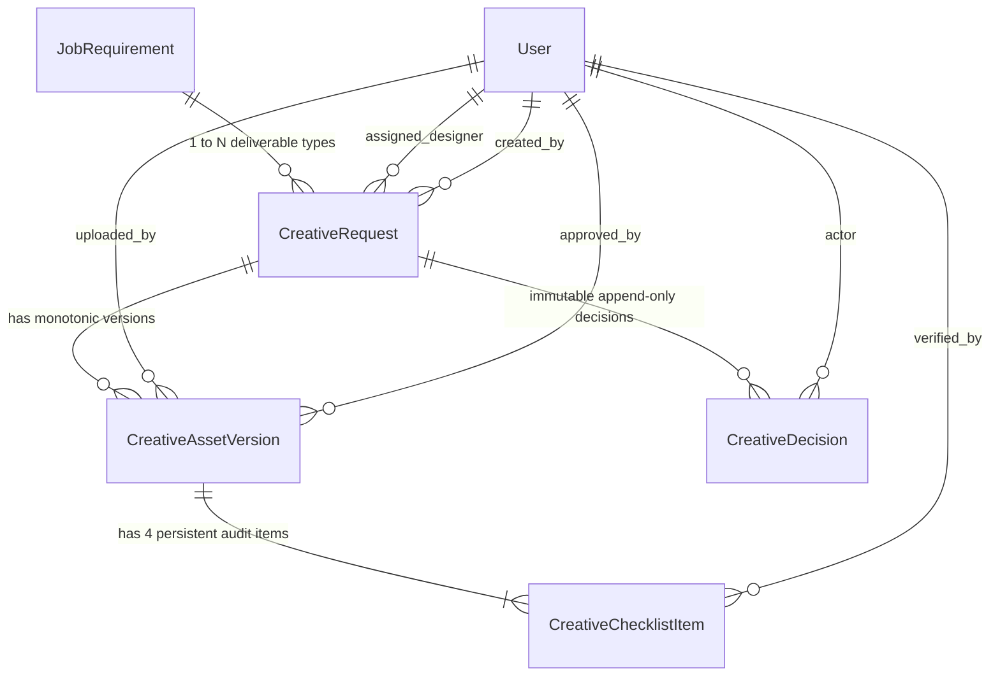

# GQT HRMS — Creative Studio & Promotional Assets Data Model
## Domain Architecture: `apps.creatives` (Steps 8–9)

### 1. Architectural Overview

The Creative Studio domain manages the production, multi-format delivery, versioning, verification, and Placement Head approval of promotional assets for approved job requirements. It enforces strict relational integrity with `apps.jobs.JobRequirement`, audit trail immutability, zero-trust file upload validation, monotonic version numbering, and persistent 4-point design verification records.

---

### 2. Entity Relationship Diagram (ERD)

---

### 3. Database Models

#### 3.1 `CreativeRequest` (`apps.creatives.models.CreativeRequest`)
Represents a creative production brief tied directly to an approved Job Requirement.

| Column | Type | Constraints / References | Description |
| :--- | :--- | :--- | :--- |
| `id` | UUID | PK, default `uuid.uuid4` | Unique request identifier |
| `job_requirement_id` | UUID | FK -> `jobs.JobRequirement` (`PROTECT`) | Linked approved corporate requirement |
| `title` | VARCHAR(255) | NOT NULL | Campaign deliverable title |
| `deliverable_type` | VARCHAR(32) | NOT NULL, choices: `FLYER`, `BANNER`, `SOCIAL_POST`, `COMBINED_PACK` | Promotional deliverable category |
| `status` | VARCHAR(32) | NOT NULL, default: `DRAFT` | Lifecycle state (`DRAFT`, `ASSIGNED`, `IN_PRODUCTION`, `REVIEW_PENDING`, `CHANGES_REQUESTED`, `APPROVED`, `REJECTED`, `CANCELLED`) |
| `priority` | VARCHAR(16) | NOT NULL, default: `MEDIUM` | Delivery urgency: `LOW`, `MEDIUM`, `HIGH`, `URGENT` |
| `brief` | TEXT | NOT NULL | Creative requirements and copy guidelines |
| `target_audience` | VARCHAR(255) | NOT NULL | Student eligibility cohort summary |
| `registration_url` | URL | NOT NULL | Student application link |
| `qr_code_target_url`| URL | NOT NULL | High-contrast QR destination URL |
| `contact_email` | EMAIL | NOT NULL | Placement cell contact email |
| `contact_phone` | VARCHAR(32) | NOT NULL | Placement cell contact phone |
| `assigned_designer_id` | UUID | FK -> `accounts.User` (`SET_NULL`, NULL) | Assigned Graphic Designer |
| `production_deadline` | DATETIME | NULLABLE | Target completion timestamp |
| `is_archived` | BOOLEAN | default: `False` | Soft deletion status |
| `created_by_id` | UUID | FK -> `accounts.User` (`PROTECT`) | Request initiator |
| `created_at` | DATETIME | auto_now_add | Creation timestamp |
| `updated_at` | DATETIME | auto_now | Last modification timestamp |

**Integrity Constraints:**
* `UniqueConstraint(fields=['job_requirement', 'deliverable_type'], condition=Q(is_archived=False) & ~Q(status='CANCELLED'))`: Prevents duplicate active creative requests for the same job and deliverable type.

---

#### 3.2 `CreativeAssetVersion` (`apps.creatives.models.CreativeAssetVersion`)
Monotonically numbered promotional asset revisions.

| Column | Type | Constraints / References | Description |
| :--- | :--- | :--- | :--- |
| `id` | UUID | PK, default `uuid.uuid4` | Version identifier |
| `creative_request_id` | UUID | FK -> `CreativeRequest` (`CASCADE`) | Parent creative request |
| `version_number` | POSITIVE INT | NOT NULL | Monotonic sequence number (v1, v2, ...) |
| `file` | FILE | `upload_to=creative_asset_upload_path` | Authenticated binary storage path |
| `file_name` | VARCHAR(255) | NOT NULL | Original sanitized filename |
| `file_size_bytes` | BIGINT | NOT NULL | Validated file size (max 10MB) |
| `mime_type` | VARCHAR(100) | NOT NULL | Detected MIME type (PNG, JPEG, WEBP, PDF) |
| `sha256_hash` | VARCHAR(64) | NOT NULL | Cryptographic file fingerprint |
| `width_px` | INT | NULLABLE | Pixel width extracted purely without PIL |
| `height_px` | INT | NULLABLE | Pixel height extracted purely without PIL |
| `status` | VARCHAR(32) | NOT NULL, default: `DRAFT` | Version review state (`DRAFT`, `SUBMITTED`, `IN_REVIEW`, `CHANGES_REQUESTED`, `APPROVED`, `REJECTED`) |
| `designer_notes` | TEXT | BLANK | Designer release notes or revision summary |
| `is_approved` | BOOLEAN | default: `False` | Explicit sign-off boolean flag |
| `approved_by_id` | UUID | FK -> `accounts.User` (`SET_NULL`, NULL) | Placement Head who signed off |
| `approved_at` | DATETIME | NULLABLE | Sign-off timestamp |
| `uploaded_by_id` | UUID | FK -> `accounts.User` (`PROTECT`) | Designer who uploaded this version |
| `created_at` | DATETIME | auto_now_add | Version upload timestamp |

**Integrity Constraints:**
* `UniqueConstraint(fields=['creative_request', 'version_number'])`: Ensures unique monotonic numbering per request.
* `CheckConstraint(check=Q(version_number__gte=1))`: Prohibits zero or negative version indices.

---

#### 3.3 `CreativeChecklistItem` (`apps.creatives.models.CreativeChecklistItem`)
Persistent 4-point design verification audit items automatically initialized on each uploaded asset version.

| Column | Type | Constraints / References | Description |
| :--- | :--- | :--- | :--- |
| `id` | UUID | PK, default `uuid.uuid4` | Checklist item identifier |
| `version_id` | UUID | FK -> `CreativeAssetVersion` (`CASCADE`) | Associated asset version |
| `item_code` | VARCHAR(64) | NOT NULL, choices: `FLYER_ACCURACY`, `OFFICIAL_LOGO`, `QR_CODE`, `REGISTRATION_LINK_AND_CONTACTS` | Authoritative check code |
| `title` | VARCHAR(255) | NOT NULL | Descriptive checklist heading |
| `description` | TEXT | NOT NULL | Detailed verification requirements |
| `is_mandatory` | BOOLEAN | default: `True` | Mandatory completion requirement |
| `status` | VARCHAR(32) | NOT NULL, default: `PENDING` | Check status: `PENDING`, `VERIFIED`, `REJECTED`, `WAIVED` |
| `verified_by_id` | UUID | FK -> `accounts.User` (`SET_NULL`, NULL) | Placement Officer or Head who verified |
| `verified_at` | DATETIME | NULLABLE | Verification timestamp |
| `remarks` | TEXT | BLANK | Audit observations or defect notes |
| `created_at` | DATETIME | auto_now_add | Initialization timestamp |
| `updated_at` | DATETIME | auto_now | Item update timestamp |

**Integrity Constraints:**
* `UniqueConstraint(fields=['version', 'item_code'])`: Guarantees exactly one audit record per criterion per version.

---

#### 3.4 `CreativeDecision` (`apps.creatives.models.CreativeDecision`)
Append-only immutable audit log tracking all workflow actions, assignments, revision requests, and sign-offs.

| Column | Type | Constraints / References | Description |
| :--- | :--- | :--- | :--- |
| `id` | UUID | PK, default `uuid.uuid4` | Decision log identifier |
| `creative_request_id` | UUID | FK -> `CreativeRequest` (`CASCADE`) | Targeted request |
| `action` | VARCHAR(32) | NOT NULL | Action type: `CREATED`, `ASSIGNED`, `SUBMITTED`, `CHANGES_REQUESTED`, `APPROVED`, `REJECTED`, `REOPENED` |
| `actor_id` | UUID | FK -> `accounts.User` (`PROTECT`) | Authenticated user executing the action |
| `version_number` | INT | NULLABLE | Associated asset version index |
| `notes` | TEXT | NOT NULL | Audit feedback, decision justification, or instructions |
| `created_at` | DATETIME | auto_now_add | Immutably stamped timestamp |

---

### 4. Indexing & Optimization Strategy

1. `Index(fields=['job_requirement', 'status'])`: High-speed lookup of campaign assets for approved job requirements.
2. `Index(fields=['assigned_designer', 'status'])`: Efficient queries for the Graphic Designer workbench.
3. `Index(fields=['status', 'production_deadline'])`: Fast filtering for approaching deadlines and review queues.
4. `Index(fields=['version', 'status'])`: Rapid evaluation of checklist verification completion.
