# GQT HRMS — Corporate CRM Data Model Specification

## 1. Overview
The Corporate CRM module (`apps.crm`) provides persistent entities and data integrity constraints for the corporate hiring relationship lifecycle (Workflow Steps 1–4). All models inherit from Django ORM with Supabase PostgreSQL 16 as the target production database.

---

## 2. Entity Relationship Diagram

```mermaid
erDiagram
    User ||--o{ Company : "owns / creates"
    User ||--o{ HRContact : "manages"
    User ||--o{ OutreachLog : "performs"
    User ||--o{ FollowUp : "assigned_to"
    Company ||--o{ HRContact : "employs"
    Company ||--o{ OutreachLog : "target"
    Company ||--o{ FollowUp : "subject"
    HRContact ||--o{ OutreachLog : "recipient"
    HRContact ||--o{ FollowUp : "counterpart"
    OutreachLog ||--o| FollowUp : "triggers"

    Company {
        uuid id PK
        string name
        string normalized_name
        string website
        string domain
        string domain_category
        string tier
        string relationship_status
        string source
        string city
        string state
        string country
        text address
        text notes
        uuid owner_id FK
        boolean is_archived
        boolean is_deleted
        datetime created_at
        datetime updated_at
    }

    HRContact {
        uuid id PK
        uuid company_id FK
        string name
        string designation
        string department
        string email
        string phone
        string alt_phone
        string linkedin_url
        string preferred_channel
        string status
        uuid owner_id FK
        text notes
        boolean is_archived
        boolean is_deleted
        datetime created_at
        datetime updated_at
    }

    OutreachLog {
        uuid id PK
        uuid company_id FK
        uuid hr_contact_id FK
        uuid performed_by_id FK
        string channel
        string direction
        datetime activity_date
        string outcome
        string subject
        text notes
        boolean followup_required
        string correlation_id
        datetime created_at
    }

    FollowUp {
        uuid id PK
        uuid company_id FK
        uuid hr_contact_id FK
        uuid related_outreach_id FK
        uuid assigned_to_id FK
        datetime due_date
        string priority
        string status
        string purpose
        text completion_notes
        datetime completed_at
        uuid completed_by_id FK
        text cancellation_reason
        int rescheduled_count
        datetime created_at
        datetime updated_at
    }

    CRMConfiguration {
        int id PK
        string key UK
        string value
        text description
        datetime updated_at
    }
```

---

## 3. Entity Details and Field Rules

### A. Company (`crm_company`)
- **Primary Key**: `id` UUIDv4 (cryptographically non-enumerable).
- **Name & Normalization**:
  - `name`: Legal or operating brand name.
  - `normalized_name`: Lowercase, punctuation-stripped, whitespace-compressed canonical string computed during `save()` via `normalize_company_name()`.
- **Domain Identification**:
  - `website`: URL field, optional (supports companies without websites).
  - `domain`: Canonical corporate root domain (e.g. `infosys.com` extracted from `https://www.infosys.com/careers`).
- **Domain Categorization**:
  - `domain_category`: Choices: `IT_SERVICES`, `PRODUCT_TECH`, `CORE_ENGINEERING`, `FINANCE_BANKING`, `BPO_ITES`, `EDTECH`, `HEALTHCARE`, `CONSULTING`, `OTHER`.
- **Tier & Relationship Lifecycle**:
  - `tier`: `TIER_1` (Enterprise/MNC), `TIER_2` (Mid-Market), `TIER_3` (Startup).
  - `relationship_status`: `DISCOVERED`, `OUTREACH_IN_PROGRESS`, `CONNECTED`, `INTERESTED`, `ACTIVE_HIRING_PARTNER`, `NOT_INTERESTED`, `ON_HOLD`.
- **Ownership & Soft Archival**:
  - `owner`: Relationship manager FK to `accounts.User`.
  - `is_archived`: Boolean flag preserving referential integrity for historical outreach.
  - `is_deleted`: Soft deletion flag inherited from `TimeStampedModel`.

### B. HRContact (`crm_hr_contact`)
- **Primary Key**: UUIDv4.
- **Company Relationship**: `company` FK on_delete `CASCADE` (contact belongs to exactly one company).
- **Communication Fields**: `email`, `phone`, `alt_phone`, `linkedin_url`.
- **Operational Status**: `ACTIVE`, `PROSPECT`, `INACTIVE`, `BOUNCED_INVALID`, `LEFT_COMPANY`.
- **Preferred Channel**: `CALL`, `EMAIL`, `LINKEDIN`, `WHATSAPP`, `IN_PERSON`.
- **Referential Preservation**: Historical `OutreachLog` records maintain FK reference even if contact is archived (`is_archived=True`).

### C. OutreachLog (`crm_outreach_log`)
- **Append-Only Entity**: No editing or arbitrary deletion permitted by standard users.
- **Foreign Keys**:
  - `company`: Required FK to `Company`.
  - `hr_contact`: Optional FK to `HRContact` (strictly validated to belong to `company`).
  - `performed_by`: Protected FK to `User` who executed the outreach.
- **Channel**: `CALL`, `EMAIL`, `LINKEDIN`, `WHATSAPP`, `IN_PERSON`, `OTHER`.
- **Direction**: `OUTBOUND` or `INBOUND`.
- **Activity Timestamp**: `activity_date` with timezone awareness (defaults to `timezone.now`).
- **Outcomes**:
  - `CONNECTED_INTERESTED`, `CONNECTED_NOT_INTERESTED`, `CONNECTED_CALL_LATER`, `NO_ANSWER_BUSY`, `INVALID_CONTACT_DETAILS`, `GATEKEEPER_BLOCKED`, `FOLLOW_UP_SCHEDULED`, `REQUIREMENT_COLLECTED`.

### D. FollowUp (`crm_follow_up`)
- **Primary Key**: UUIDv4.
- **Lifecycle Statuses**:
  - `OPEN` $\rightarrow$ `IN_PROGRESS` $\rightarrow$ `COMPLETED` or `CANCELLED`.
  - `reopen`: Explicit authorized transition returning `COMPLETED` or `CANCELLED` task to `OPEN`.
- **Dynamic Overdue State**: Computed property `is_overdue`:
  $$\text{is\_overdue} = (\text{status} \in \{\text{OPEN}, \text{IN\_PROGRESS}\}) \land (\text{due\_date} < \text{timezone.now()})$$
- **Rescheduling History**:
  - Rescheduling increments `rescheduled_count` and updates `due_date`, recording old and new timestamps in `core_audit_log`.

### E. CRMConfiguration (`crm_configuration`)
- Key-value table storing configurable operational targets:
  - `DAILY_OUTREACH_TARGET`: default `100`.

---

## 4. Database Indexes
1. `crm_company`: `(domain_category, relationship_status)`, `normalized_name`, `domain`, `(is_archived, relationship_status)`.
2. `crm_hr_contact`: `(company, is_archived)`, `email`, `phone`.
3. `crm_outreach_log`: `(activity_date, channel)`, `(company, -activity_date)`, `(performed_by, activity_date)`.
4. `crm_follow_up`: `(status, due_date)`, `(assigned_to, status, due_date)`, `(company, status)`.
