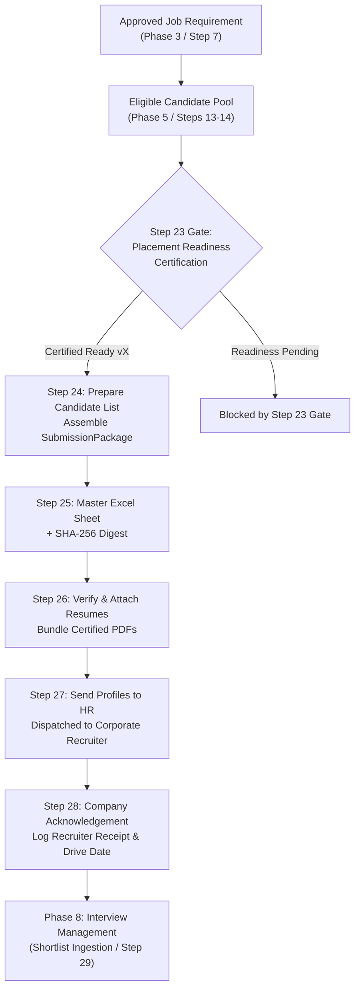

# GQT HRMS — Phase 7: Candidate Submission & Profile Dispatch Business Rules
## Workflow Steps 24–28 Comprehensive Specification & Architecture

---

### 1. Architectural Domain Mapping

Phase 7 implements **Workflow Steps 24 to 28** from the authoritative `HRMS - Complete Workflow` source document. It serves as the institutional bridge between internal candidate preparation and external corporate recruitment drives.

---

### 2. Detailed Step-by-Step Business Rules

#### Step 24: Prepare Candidate List
- **Business Purpose:** Filter the candidate pool for an approved/published job drive, verifying eligibility and enforcing the authoritative Step 23 Placement Readiness Certification Gate.
- **Prerequisites & Decision Gates:**
  1. `JobRequirement` must be in `APPROVED` or `PUBLISHED` status. Jobs in `DRAFT`, `PENDING_VERIFICATION`, or `REJECTED` are strictly rejected.
  2. Each student must have applied for the job (`StudentApplication` in `ELIGIBLE` or `OVERRIDDEN`) or belong to the finalized `CandidateCohort` (`CohortMember.is_eligible = True`).
  3. **Mandatory Step 23 Gate:** Candidate **MUST** have an active `PlacementReadinessCertification` with `is_approved_for_placements = True` and `status = 'CERTIFIED'`. Uncertified students cannot be submitted.
  4. Deduplication: Students already included in an active (non-cancelled) submission package for the same job cannot be re-added.
- **State Transition:** Creates `SubmissionPackage` in status `DRAFT`. Creates `CandidateSubmission` for each student in status `PENDING`, taking a frozen snapshot of academic metrics and the exact approved resume version.
- **Authorized Roles:** `PLACEMENT_OFFICER`, `PLACEMENT_HEAD`, `ADMIN`.

#### Step 25: Generate Candidate Roster Spreadsheet (Master Excel Sheet)
- **Business Purpose:** Automatically compile a standardized master XLSX spreadsheet with student academic and contact details, formatted with official GQT deep navy branding (`#1B365D`).
- **Data Columns:**
  1. Sl. No.
  2. Roll Number (Normalized uppercase)
  3. Candidate Name
  4. Email Address
  5. Contact Number
  6. Degree & College Name
  7. Branch / Department
  8. Graduation Year
  9. CGPA / Percentage
  10. Key Technical Skills
  11. Approved Resume Version Reference (`Resume vX`)
  12. Resume SHA-256 Digest Preview
- **Cryptographic Tamper Protection:**
  - A cryptographic SHA-256 digest is calculated over the raw generated Excel byte stream.
  - The digest is stored in `SubmissionPackage.package_hash` and logged in the immutable audit trail.
  - Streaming authenticated download endpoint `/api/v1/submissions/packages/<id>/roster/download/` serves the file to authorized placement staff.
- **Authorized Roles:** `PLACEMENT_OFFICER`, `PLACEMENT_HEAD`, `ADMIN`, `AUDITOR` (download).

#### Step 26: Attach Resumes
- **Business Purpose:** Bundle the exact certified PDF resume versions corresponding to the roster entries.
- **Validation & Tamper Invariants:**
  - Verifies that every candidate's resume PDF exists in private storage.
  - Computes and cross-verifies the binary SHA-256 hash against the certification record. If any document differs from the certified snapshot, the operation fails closed.
  - Candidate Data Minimization: Excludes internal assessment scores, evaluator notes, and private student remarks.
- **State Transition:** Package status moves from `DRAFT` to `READY_FOR_DISPATCH`.
- **Authorized Roles:** `PLACEMENT_OFFICER`, `PLACEMENT_HEAD`, `ADMIN`.

#### Step 27: Send Candidate Profiles to HR (Dispatch)
- **Business Purpose:** Formally transmit candidate profiles, roster spreadsheet, and attached resumes to the corporate HR partner.
- **Transmission Channels:** `EMAIL` (primary), `WHATSAPP`, `PORTAL_LINK`, `DIRECT_HANDOFF`.
- **Concurrency & Provider Interface:**
  - Employs database row locking (`select_for_update`) to prevent concurrent duplicate transmissions.
  - Generates an external provider tracking reference (`MSG-DISP-<UUID>`).
  - Records an immutable `SubmissionDispatchLog` entry tracking attempt number, channel, recipient destination, timestamp, and initiating actor.
- **Multi-Record State Transition:**
  - `SubmissionPackage.status` -> `DISPATCHED`
  - All `CandidateSubmission.status` -> `SUBMITTED`
- **Authorized Roles:** `PLACEMENT_OFFICER`, `PLACEMENT_HEAD`, `ADMIN`.

#### Step 28: Company Acknowledgement
- **Business Purpose:** Log corporate HR recruiter receipt confirmation, preliminary candidate pool feedback, tentative interview drive date, and follow-up callback schedule.
- **Prerequisites:** Package must be in `DISPATCHED` status.
- **Data Recorded:**
  - Recruiter Contact Name
  - Confirmation Channel (Email, Phone, WhatsApp, Portal, In-Person)
  - Preliminary Feedback / Remarks
  - Tentative Interview Drive Date
  - Follow-up Callback Timeline
- **State Transition:**
  - `SubmissionPackage.status` -> `ACKNOWLEDGED`
  - All `CandidateSubmission.status` -> `ACKNOWLEDGED`
- **Authorized Roles:** `PLACEMENT_OFFICER`, `PLACEMENT_HEAD`, `HR_RELATIONSHIP_MGR`, `ADMIN`.

---

### 3. Role-Based Access Control (RBAC) Matrix

| Workflow Action | Admin | Placement Head | Placement Officer | HR Relationship Mgr | Auditor | Student |
| :--- | :---: | :---: | :---: | :---: | :---: | :---: |
| **Preview Job Candidates (Step 24)** | Allowed | Allowed | Allowed | Denied | Denied | Denied |
| **Create Submission Package (Step 24)** | Allowed | Allowed | Allowed | Denied | Denied | Denied |
| **Generate Master Excel Roster (Step 25)** | Allowed | Allowed | Allowed | Denied | Denied | Denied |
| **Download Master Excel Roster** | Allowed | Allowed | Allowed | Allowed | Allowed | Denied |
| **Attach Certified Resumes (Step 26)** | Allowed | Allowed | Allowed | Denied | Denied | Denied |
| **Send Profiles to HR (Step 27)** | Allowed | Allowed | Allowed | Denied | Denied | Denied |
| **Record Recruiter Acknowledgment (Step 28)** | Allowed | Allowed | Allowed | Allowed | Denied | Denied |
| **View Own Submission Status** | N/A | N/A | N/A | N/A | N/A | Allowed (Self Only) |

---

### 4. Candidate Data Privacy & Isolation

1. **Anti-Tampering Resume Locking:**
   - Submissions query strictly the `approved_resume` recorded in `PlacementReadinessCertification`. A candidate or trainer cannot swap out a resume version once certified.
2. **Data Minimization:**
   - Employer-facing rosters and downloads contain strictly approved academic credentials, contact info, and certified resume links.
   - Internal assessment question-level answers, mock interview evaluator notes, and private staff comments are omitted from corporate exports.
3. **Student Privacy Isolation:**
   - Enrolled students access only `/api/v1/submissions/my-submissions/` which filters records where `student__user = request.user`. Foreign submissions return `403 Forbidden` or empty results.

---

### 5. Open Business Decisions & Governance Items

The authoritative source document (`HRMS - Complete Workflow`) establishes the linear submission sequence (Steps 24–28). The following operational decisions remain open for executive institutional resolution by GQT:

1. **Submission Package Size Limits:**
   - *Current Implementation:* System permits any batch size >= 1 candidate.
   - *Open Decision:* Whether GQT mandates a hard upper limit (e.g. max 50 or 100 profiles per email batch) or enforces department quotas.
2. **Multi-Job Submission Concurrency:**
   - *Current Implementation:* Candidates can be submitted to different approved job requirements simultaneously.
   - *Open Decision:* Whether an institutional policy should cap the maximum number of concurrent active corporate submissions per candidate (e.g. max 3 concurrent company submissions).
3. **Resubmission After Rejection:**
   - *Current Implementation:* When a package is marked `CANCELLED`, candidates become re-eligible for new package preparation for that job.
   - *Open Decision:* Whether recruiter rejection at Step 28 permanently closes applications for that drive or allows improved resume re-submission.
