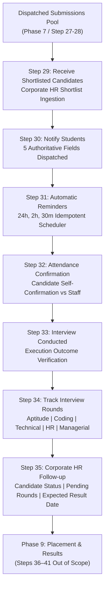

# GQT HRMS — Phase 8: Interview Management & Tracking Business Rules
## Workflow Steps 29–35 Comprehensive Specification & Architecture

---

### 1. Architectural Domain Mapping

Phase 8 implements **Workflow Steps 29 to 35** from the authoritative `HRMS - Complete Workflow` source document. It governs the recruitment execution lifecycle following profile dispatch (Phase 7), managing corporate shortlist intake, multi-channel scheduling, automatic reminder engines, student attendance confirmations, interview execution outcomes, multi-round technical tracking, and corporate HR follow-ups.

---

### 2. Detailed Step-by-Step Business Rules

#### Step 29: Receive Shortlisted Candidates
- **Business Purpose:** Receive and record the shortlist of candidates selected for interviews by corporate HR recruiters for an approved job requirement.
- **Prerequisites & Domain Invariants:**
  1. `JobRequirement` must be in `APPROVED` status.
  2. Candidates referenced must belong to the active pool of `CandidateSubmission` records previously dispatched for that specific job (`CandidateSubmission.status == SUBMITTED`).
  3. Rejects unknown candidates, students not associated with the recruitment process, and cross-company associations.
  4. Deduplication: Shortlists are identified by an institutional reference code (`SL-YYYYMMDD-XXXX`). Duplicate candidate intake under the same active shortlist is prevented.
  5. Upon intake, updates each referenced candidate's `CandidateSubmission.status` from `SUBMITTED` to `SHORTLISTED`.
- **State Persistence:** Creates `CandidateShortlist` linked to `JobRequirement`, `Company`, `HRContact`, and optional `SubmissionPackage`. Creates `ShortlistedCandidate` junction records for each student.
- **Authorized Roles:** `PLACEMENT_OFFICER`, `PLACEMENT_HEAD`, `ADMIN`, `HR_RELATIONSHIP_MGR`.

#### Step 30: Notify Students
- **Business Purpose:** Formally notify shortlisted students of their scheduled interview session.
- **Authoritative Notification Information (5 Core Fields):**
  1. `interview_date`: Scheduled date of the interview.
  2. `interview_time`: Scheduled local start time.
  3. `venue`: Physical venue location (required for `IN_PERSON` and `HYBRID` modes).
  4. `meeting_link`: Virtual conferencing link (required for `ONLINE` and `HYBRID` modes).
  5. `required_documents`: Explicit list of documents the candidate must present (resume copies, government photo ID, college marksheets, portfolio).
- **Interview Modes Supported:**
  - `ONLINE`: Requires valid `meeting_link`.
  - `IN_PERSON`: Requires valid physical `venue`.
  - `HYBRID`: Requires both `meeting_link` and `venue`.
- **Delivery Integrity & Privacy:**
  - Student notifications use verified institutional contact credentials.
  - Excludes other candidates' personal information, resumes, or recruiter notes.
  - Records an immutable `InterviewNotificationLog` with channel (`EMAIL`, `WHATSAPP`, `SMS`), timestamp, and actor attribution.
  - Safe test/development adapters record delivery attempts without claiming real external delivery when live credentials are not configured.
- **Authorized Roles:** `PLACEMENT_OFFICER`, `PLACEMENT_HEAD`, `ADMIN`.

#### Step 31: Automatic Reminders
- **Business Purpose:** Deliver timely interview reminders to shortlisted candidates prior to their scheduled sessions.
- **Authoritative Intervals:**
  1. **24 hours prior** (`24_HOURS`)
  2. **2 hours prior** (`2_HOURS`)
  3. **30 minutes prior** (`30_MINUTES`)
- **Engine Rules & Concurrency Invariants:**
  - **Pre-generation:** When an `InterviewSchedule` is created, the system calculates and persists 3 timezone-aware `InterviewReminder` records.
  - **Short-Notice Scheduling Policy:** If an interview is scheduled with less lead time than a reminder window (e.g., scheduled 1 hour before start time), any past-due window is marked `SKIPPED` with a clear explanation rather than sending misleading retroactive alerts.
  - **Rescheduling & Cancellation:** When an interview is rescheduled or cancelled, all existing un-sent reminders are invalidated (`CANCELLED`), and a fresh set of reminders is computed for the new timestamp.
  - **Idempotent Background Processing:** Reminders due for processing (`status == 'SCHEDULED'` and `scheduled_for <= now`) are locked with row-level locks (`select_for_update(skip_locked=True)`) to ensure two concurrent worker tasks never dispatch duplicate notifications.
- **Authorized Roles:** System background scheduler or manual trigger by `PLACEMENT_OFFICER`, `PLACEMENT_HEAD`, `ADMIN`.

#### Step 32: Attendance Confirmation
- **Business Purpose:** Capture candidate confirmation of attendance prior to the interview session.
- **Attendance Statuses:**
  - `CONFIRMED`: Candidate explicitly confirms readiness to attend.
  - `DECLINED`: Candidate reports inability or refusal to attend (requires reason).
  - `TENTATIVE`: Candidate requests clarification or tentative hold.
  - `NO_RESPONSE`: Initial default status before candidate response.
- **Attribution & History:**
  - Distinguishes **student self-confirmation** (`attendance_source = 'STUDENT_PORTAL'`) from **staff-recorded confirmation** (`attendance_source = 'PLACEMENT_OFFICE'`).
  - Candidate intention to attend is strictly separated from actual attendance during the interview.
  - Preserves timestamp (`attendance_confirmed_at`) and auditing attribution (`attendance_confirmed_by`).
- **Authorized Roles:** Student candidate (for own schedule), `PLACEMENT_OFFICER`, `PLACEMENT_HEAD`, `ADMIN`.

#### Step 33: Interview Conducted
- **Business Purpose:** Formally record whether the scheduled interview session was executed by the corporate panel.
- **Conducted Statuses:**
  - `CONDUCTED`: Interview session occurred as scheduled.
  - `NOT_CONDUCTED`: Session did not occur.
  - `CANDIDATE_ABSENT`: Candidate failed to appear.
  - `INTERVIEWER_ABSENT`: Corporate interviewer panel was unavailable.
  - `RESCHEDULED`: Session was postponed to a later date.
- **Strict Boundary Invariants:**
  - Recording that an interview was `CONDUCTED` does **NOT** imply candidate selection, job offer, or placement outcome (Steps 36–41).
  - Attendance confirmation (Step 32) and interview execution (Step 33) remain distinct concepts.
- **Authorized Roles:** `PLACEMENT_OFFICER`, `PLACEMENT_HEAD`, `ADMIN`, `HR_RELATIONSHIP_MGR`.

#### Step 34: Track Interview Rounds
- **Business Purpose:** Track candidate progression across multiple progressive interview assessment stages.
- **Authoritative Categories (5 Defined Types):**
  1. `APTITUDE`: Written or cognitive screening assessment.
  2. `CODING`: Technical coding, data structures, or algorithm evaluation.
  3. `TECHNICAL`: System design, architecture, or domain interview.
  4. `HR`: Behavioral, cultural fit, and background interview.
  5. `MANAGERIAL`: Executive, managerial, or leadership interaction.
- **Lifecycle & Data Isolation:**
  - Rounds are numbered sequentially (`round_number: 1, 2, ...`).
  - Round statuses: `SCHEDULED`, `CLEARED`, `NOT_CLEARED`, `ON_HOLD`.
  - **Candidate Data Isolation:** Internal confidential staff notes (`internal_staff_notes`) are strictly stripped from student serializers and API responses.
  - Round completion does not automatically mark a candidate as placed or rejected for employment.
- **Authorized Roles:** `PLACEMENT_OFFICER`, `PLACEMENT_HEAD`, `ADMIN`, `HR_RELATIONSHIP_MGR`.

#### Step 35: Corporate HR Follow-up
- **Business Purpose:** Maintain systematic follow-ups with corporate HR recruiters following interview drives to track recruitment status.
- **Authoritative Follow-up Metrics (3 Core Requirements):**
  1. `candidate_status_reported`: Recruiter-reported candidate progression status (e.g., "Round 1 evaluations completed; Round 2 shortlist shared").
  2. `pending_rounds`: Outstanding interview stages still pending completion.
  3. `expected_result_date`: Expected date for final interview outcomes, with explicit flag `is_date_confirmed` (confirmed firm vs tentative estimate).
- **Callback Tracking:**
  - Supports scheduling a `next_follow_up_date` for placement officers.
  - Tracks response status: `PENDING_RESPONSE`, `RESPONSE_RECEIVED`, `NO_RESPONSE`, `RESCHEDULED`.
- **Authorized Roles:** `PLACEMENT_OFFICER`, `PLACEMENT_HEAD`, `HR_RELATIONSHIP_MGR`, `ADMIN`.

---

### 3. Role & Permission Matrix

| Operation | Student | Placement Officer | Placement Head | HR Relationship Mgr | Admin |
|:---|:---:|:---:|:---:|:---:|:---:|
| Ingest HR Shortlist (Step 29) | ❌ | ✅ | ✅ | ✅ | ✅ |
| Create / Reschedule Schedule (Step 30) | ❌ | ✅ | ✅ | ✅ | ✅ |
| Notify Student (Step 30) | ❌ | ✅ | ✅ | ✅ | ✅ |
| Process Due Reminders (Step 31) | ❌ | ✅ | ✅ | ✅ | ✅ |
| Confirm Attendance (Self) (Step 32) | ✅ (Own only) | ✅ | ✅ | ✅ | ✅ |
| Record Interview Conducted (Step 33) | ❌ | ✅ | ✅ | ✅ | ✅ |
| Manage Interview Rounds (Step 34) | ❌ (View own only) | ✅ | ✅ | ✅ | ✅ |
| Log Corporate Follow-up (Step 35) | ❌ | ✅ | ✅ | ✅ | ✅ |

---

### 4. Non-Negotiable Scope Boundaries

- **Steps 36–41 Strictly Out of Scope:**
  - Step 36 (Placement Results & Selection Status)
  - Step 37 (Offer Letter Issuance)
  - Step 38 (Offer Acceptance Tracking)
  - Step 39 (Joining Status Verification)
  - Step 40 (Placement Documentation)
  - Step 41 (Post-Placement Feedback)
- **External Providers:**
  - Live third-party email (SendGrid/SES), WhatsApp (Twilio/Gupshup), or SMS aggregators remain unconfigured.
  - All communication logging records accurate development/simulated adapter status without fabricating delivery confirmations.
