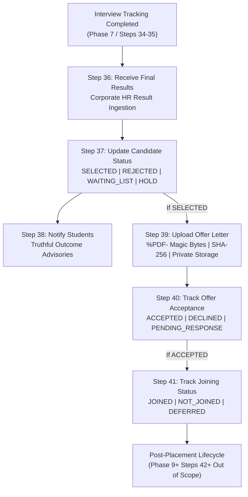

# GQT HRMS — Phase 8: Placement Management Business Rules
## Workflow Steps 36–41 Comprehensive Specification & Architecture

---

### 1. Architectural Domain Mapping

Phase 8 implements **Workflow Steps 36 to 41** from the authoritative `HRMS - Complete Workflow` source document (`HRMS Work-Flow.pdf`). It represents the decisive recruitment outcome lifecycle: receiving final corporate results, updating candidate placement states, dispatching student outcome notifications, secure offer letter document management, offer acceptance tracking, and candidate joining verification.

---

### 2. Business-Rule Decision Register

In accordance with architectural discipline, the table below documents source-defined requirements versus resolved implementation decisions and open institutional policies:

| Area | Source Workflow Specification | Resolved Implementation Rule | Status / Authority |
|:---|:---|:---|:---|
| **Result Ingestion Authority** | Received from Corporate HR | Restricted to authorized placement staff: `PLACEMENT_HEAD`, `PLACEMENT_OFFICER`, `HR_RELATIONSHIP_MGR`, and `ADMIN`. Students and external recruiters cannot directly mutate results. | Approved / Enforced |
| **Authoritative Result Format** | Recruiter final list | Supports `EMAIL`, `PORTAL`, `FILE_IMPORT`, or `DIRECT_HANDOFF`. Generates sequential reference code `RES-YYYYMMDD-XXXX`. | Approved / Enforced |
| **Prerequisites for Intake** | Shortlisted/Interviewed candidates | Candidate must be associated with the specific `JobRequirement` (submitted or shortlisted). Validates candidate IDs server-side and rejects unrelated candidates. | Approved / Enforced |
| **Candidate Status Choices** | Explicit 4 statuses: `SELECTED`, `REJECTED`, `WAITING_LIST`, `HOLD` | Strict enum `CandidatePlacementStatusChoices`. Preserves distinction: `WAITING_LIST` and `HOLD` are interim states and cannot receive offers until advanced to `SELECTED`. | Authoritative Source Rule |
| **Status Transition Corrections** | Corrections permitted with audit | Any status update preserves historical records in `PlacementStatusHistory` with previous status, new status, change reason, actor, and timestamp. Prior values are never overwritten. | Approved / Enforced |
| **Offer Letter Requirements** | PDF offer letter | Requires valid binary magic bytes `b'%PDF-'`, max size 5MB, SHA-256 integrity hash, isolated private storage, and authenticated streaming endpoint. | Strict Security Invariant |
| **Offer Replacement Policy** | Replacement allowed with audit | Replacing an offer letter archives the prior document version in `OfferLetterVersion` with monotonic versioning (`v1`, `v2`, ...). Prior documents are never deleted. | Approved / Enforced |
| **Offer Acceptance Choices** | Candidate acceptance tracking | Tracked via `PENDING_RESPONSE`, `ACCEPTED`, `DECLINED`, `EXPIRED`. Captures student self-service response via portal vs staff offline entry. | Approved / Enforced |
| **Offer Acceptance Deadlines** | Workflow does not define a mandatory deadline window | `acceptance_deadline` is nullable/optional. No guessed default deadline (e.g. 7 days) is invented. Staff may explicitly set or extend deadlines. | Non-Invented Policy |
| **Single-Job Placement Policy** | Mentioned in concept but not detailed in Steps 36–41 | To prevent unauthorized data loss, the system tracks each job drive independently. Accepting an offer does **not** silently auto-withdraw other job applications unless explicitly configured. | Safe Non-Destructive Design |
| **Joining Status Choices** | Explicit 3 statuses: `JOINED`, `NOT_JOINED`, `DEFERRED` | Tracked via `CandidateOfferLetter.joining_status`. Offer acceptance is strictly separated from joining verification. | Authoritative Source Rule |
| **Deferred Joining Policy** | Deferred status allowed | When status is `DEFERRED`, captures `deferred_joining_date` and mandatory deferral reason. | Approved / Enforced |
| **Non-Joining Reason** | Not joined status allowed | When status is `NOT_JOINED`, captures non-joining remarks and verification timestamp. | Approved / Enforced |
| **Notification Semantics** | Notify students | Dispatches truthful notifications via email/portal adapter. Logs attempts in `PlacementNotificationLog`. Does not claim third-party delivery without credentials. | Safe Adapter Boundary |

---

### 3. Detailed Step-by-Step Business Rules

#### Step 36: Receive Final Results
- **Business Purpose:** Formally record final hiring decisions communicated by corporate HR recruiters for an approved recruitment drive.
- **Prerequisites & Domain Invariants:**
  1. `JobRequirement` must be in `APPROVED` status.
  2. Each referenced candidate must belong to the active pool of students who participated in the drive (`CandidateSubmission` or `ShortlistedCandidate`).
  3. Rejects candidates unrelated to the job, students from different colleges/departments not approved for the drive, and cross-company associations.
  4. Deduplication: Batch intake is assigned a unique reference code (`RES-YYYYMMDD-XXXX`). Duplicate candidate results within the same intake are prevented.
  5. Intake records total, selected, rejected, waiting list, and hold counts for executive reporting.
- **State Persistence:** Creates `FinalResultIntake` linked to `JobRequirement`, `Company`, `HRContact`, and `created_by`. Creates individual `CandidatePlacementStatus` records.
- **Authorized Roles:** `PLACEMENT_OFFICER`, `PLACEMENT_HEAD`, `HR_RELATIONSHIP_MGR`, `ADMIN`.

#### Step 37: Update Candidate Status
- **Business Purpose:** Set and transition individual candidate placement outcome states for a job requirement.
- **Authoritative Status Choices:**
  - `SELECTED`: Candidate selected for employment by corporate recruiter. Eligible for offer letter upload.
  - `REJECTED`: Candidate not selected.
  - `WAITING_LIST`: Candidate placed on waitlist pending selected candidate responses or recruiter quota expansion.
  - `HOLD`: Decision temporarily withheld by corporate HR (e.g. pending additional review or internal budgeting).
- **Transition Validation:**
  - `WAITING_LIST` $\rightarrow$ `SELECTED`, `REJECTED`, `HOLD`
  - `HOLD` $\rightarrow$ `SELECTED`, `REJECTED`, `WAITING_LIST`
  - `SELECTED` $\rightarrow$ `REJECTED` or `HOLD` (permitted only with mandatory documented correction reason)
  - Every transition creates an immutable `PlacementStatusHistory` record.
- **Authorized Roles:** `PLACEMENT_OFFICER`, `PLACEMENT_HEAD`, `ADMIN`, `HR_RELATIONSHIP_MGR`.

#### Step 38: Notify Students
- **Business Purpose:** Dispatch formal status outcome advisories to candidates.
- **Notification Contents:**
  - `SELECTED`: Congratulatory advisory with job title, company name, offered designation, offered CTC (if available), and next steps for offer letter issuance.
  - `REJECTED`: Professional encouraging acknowledgment of drive participation and future eligibility.
  - `WAITING_LIST`: Clear communication of waitlist status and potential advancement timeline.
  - `HOLD`: Clear notice that recruiter decision is temporarily on hold.
- **Privacy & Delivery Invariants:**
  - Uses candidate's verified institutional contact information.
  - Strict student isolation: No candidate can view other candidates' results or personal information.
  - All attempts recorded in `PlacementNotificationLog` with timestamp, channel, provider ID, and actor.
  - Simulated development adapters accurately reflect unconfigured production gateways.
- **Authorized Roles:** `PLACEMENT_OFFICER`, `PLACEMENT_HEAD`, `ADMIN`.

#### Step 39: Upload Offer Letter
- **Business Purpose:** Securely store and manage official corporate offer letters for selected candidates.
- **Security & Validation Rules:**
  1. Only candidates with status `SELECTED` can have an offer letter uploaded.
  2. File signature check: Must begin with binary magic bytes `b'%PDF-'`. Plaintext files, executables, or disguised extensions are rejected.
  3. Size limit: Maximum allowable file size is 5MB (`5 * 1024 * 1024` bytes).
  4. Cryptographic integrity: Calculates binary SHA-256 digest on upload and verifies tamper-free persistence.
  5. Private storage: Files stored in isolated path `offer_letters/candidate_<id>/offer_v<version>_<uuid>.pdf`. No direct public URLs are exposed.
  6. Authenticated streaming: Endpoint `/api/v1/placements/offers/<id>/download/` streams file with `Content-Disposition`. Access granted only to the student owner or authorized placement staff/auditor.
  7. Monotonic versioning: If an offer letter is re-issued or revised, previous documents are archived in `OfferLetterVersion` rather than deleted.
- **Authorized Roles:** `PLACEMENT_OFFICER`, `PLACEMENT_HEAD`, `ADMIN`.

#### Step 40: Track Offer Acceptance
- **Business Purpose:** Capture candidate's formal decision regarding the issued offer letter.
- **Acceptance Statuses:**
  - `PENDING_RESPONSE`: Offer letter issued; awaiting candidate response.
  - `ACCEPTED`: Candidate formally accepts employment offer.
  - `DECLINED`: Candidate rejects offer (requires reason notes).
  - `EXPIRED`: Offer acceptance deadline passed without candidate response.
- **Source Attribution:**
  - Distinguishes **student self-service acceptance** (`STUDENT_PORTAL`) from **staff offline entry** (`PLACEMENT_OFFICE`).
  - Captures `student_decision_notes` and timestamp `accepted_at`.
  - Non-invented deadlines: Deadline is optional (`acceptance_deadline`). Staff may extend deadlines with an auditable log entry.
- **Authorized Roles:** Student candidate (for own offer), `PLACEMENT_OFFICER`, `PLACEMENT_HEAD`, `ADMIN`.

#### Step 41: Track Joining Status
- **Business Purpose:** Verify whether candidate has formally reported to duty on drive day or official onboarding date.
- **Authoritative Joining Statuses:**
  - `JOINED`: Candidate reported to work, verified with onboarding details (joining date, assigned employee ID, location).
  - `NOT_JOINED`: Candidate failed to report or reneged on accepted offer (requires explanation remarks).
  - `DEFERRED`: Candidate joining date postponed by company or granted academic extension (requires `deferred_joining_date` and reason).
- **Attribution & History:**
  - Verification timestamp (`joining_verified_at`) and responsible placement officer (`joining_verified_by`).
  - Audit history preserved in `JoiningStatusHistory`.
  - Offer acceptance does not automatically imply joining.
- **Authorized Roles:** `PLACEMENT_OFFICER`, `PLACEMENT_HEAD`, `ADMIN`, `HR_RELATIONSHIP_MGR`.

---

### 4. Role & Permission Matrix

| Operation | Student | Placement Officer | Placement Head | HR Relationship Mgr | Auditor | Admin |
|:---|:---:|:---:|:---:|:---:|:---:|:---:|
| Ingest Final Results (Step 36) | ❌ | ✅ | ✅ | ✅ | ❌ | ✅ |
| Update Candidate Status (Step 37) | ❌ | ✅ | ✅ | ✅ | ❌ | ✅ |
| Notify Students (Step 38) | ❌ | ✅ | ✅ | ❌ | ❌ | ✅ |
| Upload / Replace Offer Letter (Step 39) | ❌ | ✅ | ✅ | ❌ | ❌ | ✅ |
| Download Own Offer Letter (Step 39) | ✅ | ✅ | ✅ | ✅ | ✅ | ✅ |
| Accept / Decline Own Offer (Step 40) | ✅ | ❌ | ❌ | ❌ | ❌ | ❌ |
| Record Offline Offer Response (Step 40) | ❌ | ✅ | ✅ | ✅ | ❌ | ✅ |
| Verify / Update Joining Status (Step 41) | ❌ | ✅ | ✅ | ✅ | ❌ | ✅ |
| View Placement Logs & Audit | ❌ | ✅ | ✅ | ✅ | ✅ | ✅ |

---

### 5. Non-Negotiable Scope Boundaries

- **Strictly Out of Scope (Steps 42+):**
  - Phase 9: Feedback Collection (Student, HR, Trainer surveys).
  - Phase 10: CRM Database Updates (lifetime hiring analytics, automatic drive archival).
  - Phase 11: Reports & Analytics (conversion funnels, CTC stats, CSV exports).
  - Phase 12: Automated Follow-Up Campaigns (scheduled reminders, annual outreach).
  - Phase 13: Continuous Improvement & AI features.
